# Awesome Enterprise SSO (SAML 2.0 / Okta / Azure AD) 🛡️

  

  
  
  
  
  
  

---

## 🧭 Top Enterprise SSO (SAML 2.0 / Okta / Azure AD) Ecosystem

> A curated list of **Enterprise Single Sign-On (SSO)**, **SAML 2.0 Federation**, **OpenID Connect (OIDC)** providers, and **self-hosted open-source Identity Providers (IdP)**.

Single Sign-On (SSO) and identity federation form the cornerstone of modern Zero-Trust architectures and enterprise security posture. This repository tracks notable enterprise **SaaS platforms** and production-ready **open-source identity projects**—spanning commercial Identity-as-a-Service (IDaaS) leaders like Okta and Microsoft Entra ID to high-performance open-source federated identity servers supporting SAML 2.0, OIDC, OAuth 2.0, and SCIM 2.0 without compounding per-seat SaaS tax.

---

## 📑 Table of Contents
- [📊 Sector Overview & Market Dynamics](#-sector-overview--market-dynamics)
- [☁️ SaaS & Commercial Hosted Platforms](#️-saas--commercial-hosted-platforms)
- [🔓 Open-Source GitHub Projects](#-open-source-github-projects)
- [🛠️ Architectural Guidance & Evaluation](#️-architectural-guidance--evaluation)
- [🤝 How to Contribute](#-how-to-contribute)
- [💖 Support](#-support)
- [📈 Star History](#-star-history)
- [⚠️ Disclaimer](#️-disclaimer)

---

## 📊 Sector Overview & Market Dynamics

The global Identity and Access Management (IAM) and Enterprise SSO market was valued at approximately **$16–$19 billion in 2024–2025** and is projected to surpass **$35–$40 billion by 2030–2032**, expanding at a compound annual growth rate (CAGR) of 12–14%. The sector exhibits **moderate concentration at the high-end enterprise layer**—dominated by mega-cloud ecosystems (Microsoft Entra ID, Alphabet/Google Workspace) and specialized category leaders (Okta, Ping Identity/ForgeRock, CyberArk)—while remaining **dynamic and fragmented in self-hosted, developer-first, and open-source segments** as organizations actively mitigate enterprise vendor lock-in, recurring per-seat licensing escalations, and strict data residency requirements.

---

## ☁️ SaaS & Commercial Hosted Platforms

*Ranked and sorted in descending order by estimated company scale (market valuation / revenue scale).*

| Product | Company Scale (Valuation / Revenue) | Description | Pricing (Starting) | Free Tier / Trial Limits |
|:---|:---|:---|:---|:---|
| **[Microsoft Entra ID](https://www.microsoft.com/en-us/security/business/identity-access/microsoft-entra-id)** | **~$3.1 Trillion market cap** (Microsoft Corporation; >$245B annual revenue) | **The default enterprise IAM foundation for Microsoft 365 & Azure environments.** Delivers SAML 2.0 and OIDC federation with Conditional Access and identity protection. Often bundled in enterprise licensing. | P1: **$7.00/user/month** (standalone); P2: **$10.00/user/month** | **Free edition included permanently** with Azure/M365 accounts (supports unlimited SSO apps with core directory; Conditional Access requires P1/P2) |
| **[Google Workspace](https://workspace.google.com/)** | **~$2.2 Trillion market cap** (Alphabet Inc.; >$300B annual revenue) | **Native cloud identity and SAML IdP for Google ecosystem.** Built-in SAML 2.0 identity provider capability connecting to thousands of pre-integrated SaaS apps. | Business Starter: **$7.00/user/month** (list; annual commitment ~$5.60/user/month) | **14-day free trial** with full feature access for up to 10 users; no permanent free tier |
| **[Duo](https://duo.com/editions-and-pricing)** | **~$230 Billion market cap** (Cisco Systems; acquired for $2.35B) | **Zero-trust access and multi-factor authentication with cloud SSO.** Provides user-friendly MFA combined with a turnkey SAML/OIDC Single Sign-On application launcher. | Duo Essentials (includes SSO): **$3.00/user/month**; Advantage: **$6.00/user/month** | **Duo Free plan permanently available for up to 10 users** (includes core MFA and unlimited devices; cloud SSO requires upgrade to 30-day trial or Essentials) |
| **[CyberArk Identity](https://www.cyberark.com/)** | **~$15 Billion market cap** (CyberArk Software Ltd.; NASDAQ: CYBR) | **Privilege-first workforce identity and access management.** Enterprise Single Sign-On with contextual adaptive MFA, self-service password resets, and user lifecycle automation. | Workforce Identity SSO standalone: **$2.00/user/month** (annual contract); bundled suites ~$9.00/user/month | **30-day fully functional free trial** for workforce identity and SSO; no permanent free tier |
| **[Okta](https://www.okta.com/)** | **~$13 Billion market cap** (Okta, Inc.; NASDAQ: OKTA; >$2.4B annual revenue) | **The independent standard in Enterprise Identity-as-a-Service (IDaaS).** Workforce Identity Cloud provides SAML 2.0/OIDC federation, Universal Directory, and automated SCIM provisioning across 7,000+ app integrations. | Starter: **$6.00/user/month** (annual contract; includes SSO + MFA); Essentials: **$17.00/user/month**; subject to **$1,500/year minimum spend** | **30-day free trial** of Workforce Identity Cloud with full enterprise features; no permanent free workforce tier |
| **[Auth0](https://auth0.com/pricing)** | **Acquired by Okta for $6.5 Billion** (part of Okta, Inc. Customer Identity Cloud) | **Developer-centric identity platform providing universal authentication.** Enables quick integration of universal login, social federation, SAML enterprise connections, and user management. | B2B Essentials: **$130/month** (includes up to 500 regular MAU; Enterprise SAML/SSO requires Enterprise Custom plan, typically starting ~$1,500/mo) | **Free tier forever for up to 25,000 MAU** (includes social login, MFA, and standard authentication; Enterprise SAML SSO requires Enterprise plan or 22-day Enterprise trial) |
| **[PingFederate](https://www.pingidentity.com/)** | **Acquired by Thoma Bravo for $2.8 Billion** (merged with ForgeRock) | **High-assurance enterprise federation server.** Built for complex hybrid deployments supporting SAML 2.0, WS-Federation, WS-Trust, OAuth 2.0, and OpenID Connect with fine-grained policy orchestration. | Essential Plan starts at **~$35,000/year** (enterprise annual contract; no monthly billing) | **30-day enterprise evaluation trial** available upon request; no permanent free tier |
| **[Druva SSO](https://help.druva.com/en/articles/8580828-set-up-single-sign-on-sso)** | **~$2 Billion private valuation** (Backed by Neuberger Berman, Riverwood, Viking) | **SAML 2.0 federated authentication for Druva Data Security Cloud.** Integrates seamlessly with external IdPs (Okta, Azure AD, Ping) via Assertion Consumer Service (`DCP-login`). | **Bundled at $0 additional cost** with core Druva SaaS subscription (starting from ~$2.50/user/month for SaaS backup) | **30-day fully featured free trial** of Druva Cloud Platform (includes full SAML 2.0 SSO configuration); no standalone free tier |
| **[OneLogin](https://www.onelogin.com/)** | **Acquired by One Identity / Quest Software** (~$1.5B+ enterprise segment) | **Cloud identity management with comprehensive application catalog.** Delivers unified access management, SAML 2.0 federation, SmartFactor MFA, and automated directory sync. | Basic: **$3.00/user/month**; Essentials: **$6.00/user/month**; Business: **$10.00/user/month** (typically requires annual agreement) | **30-day free trial** with full access to SSO catalog, smart directory, and MFA; no permanent free tier |
| **[JumpCloud](https://jumpcloud.com/)** | **~$2.6 Billion private valuation** (Backed by Sapphire Ventures, General Atlantic) | **Open directory platform unifying device management and identity.** Delivers cloud LDAP, SAML 2.0 SSO, RADIUS, cross-OS MDM (Mac, Windows, Linux), and zero-trust conditional access. | SSO package: **$11.00/user/month**; Core Directory: **$13.00/user/month** (billed annually) | **Free plan forever for up to 10 users and 10 devices** with full feature access and 10 days of complimentary premium support |

---

## 🔓 Open-Source GitHub Projects

*Ranked and sorted in descending order by GitHub stargazer count.*

| Project | GitHub_Stars | Language / Stack | License | Description |
|:---|:---:|:---|:---:|:---|
| **[Keycloak](https://github.com/keycloak/keycloak)** |  | Java / Quarkus | Apache-2.0 | **The enterprise gold standard in open-source identity and access management.** Maintained under Red Hat governance. Native support for SAML 2.0, OpenID Connect 1.0, OAuth 2.0, LDAP/Active Directory federation, multi-tenant realms, and fine-grained Service Provider Interfaces (SPIs). |
| **[Authelia](https://github.com/authelia/authelia)** |  | Go / TypeScript | Apache-2.0 | **Lightweight authentication and authorization portal companion for reverse proxies.** Integrates natively with Nginx, Traefik, Caddy, and Envoy. Implements 2FA (TOTP, FIDO2 WebAuthn), OpenID Connect provider support, and forward-auth proxy protection for homelabs and corporate internal intranets. |
| **[Authentik](https://github.com/goauthentik/authentik)** |  | Python / Go | MIT / BSL-1.1 | **Extremely versatile, flow-based modern identity provider.** Features visual authentication flow builders, turnkey SAML 2.0 and OIDC IdP endpoints, outbound SCIM 2.0 directory synchronization, LDAP server emulation, and native proxy forward authentication. |
| **[Ory Hydra](https://github.com/ory/hydra)** |  | Go | Apache-2.0 | **Hardened, headless OAuth 2.0 and OpenID Connect certified provider.** Implements modern security specifications (PKCE, FAPI, mutual TLS) designed to plug into existing enterprise login and consent screens without enforcing opinionated UI frameworks. |
| **[ZITADEL](https://github.com/zitadel/zitadel)** |  | Go / TypeScript | Apache-2.0 | **Event-sourced cloud-native identity platform with turnkey multi-tenancy.** Supports SAML 2.0, OIDC, SCIM 2.0, passkeys/WebAuthn, and audit-proof event logging. Designed with an API-first mindset exposing gRPC and REST endpoints. |
| **[SuperTokens](https://github.com/supertokens/supertokens-core)** |  | Java | Apache-2.0 | **Modular, open-source alternative to Auth0 and AWS Cognito.** Provides out-of-the-box support for Enterprise SAML SSO (integrating with Okta, Azure AD, Ping), session management, passwordless login, and pre-built frontend UI components for React, Angular, and Vue. |
| **[Logto](https://github.com/logto-io/logto)** |  | TypeScript / Node.js | AGPL-3.0 | **Next-generation auth infrastructure for web, mobile, and B2B SaaS.** Ships with multi-tenant organization support, enterprise SAML/OIDC SSO integrations, customizable sign-in experience, and extensive SDK ecosystem. |
| **[Casdoor](https://github.com/casdoor/casdoor)** |  | Go / React | Apache-2.0 | **High-performance single-binary identity and SSO platform.** Supports SAML 2.0, OIDC, CAS 2.0, LDAP, RADIUS, and SCIM 2.0 with a React-based management dashboard. Features one-click syncers from Okta, Keycloak, Azure AD, and built-in MCP server support for AI agent authentication. |
| **[Ory Kratos](https://github.com/ory/kratos)** |  | Go | Apache-2.0 | **API-first identity, user management, and credential store.** Implements secure user registration, profile management, MFA, and enterprise federation via OIDC/SAML bridging. Built on cloud-native headless architecture. |
| **[Apereo CAS](https://github.com/apereo/cas)** |  | Java / Spring Boot | Apache-2.0 | **Veteran enterprise Single Sign-On and identity federation engine.** Supports Central Authentication Service (CAS) protocol, SAML 2.0/v1.1, OAuth 2.0, OpenID Connect, and WS-Federation with extensive higher-education and government enterprise deployments worldwide. |
| **[Dex IdP](https://github.com/dexidp/dex)** |  | Go | Apache-2.0 | **Cloud Native Computing Foundation (CNCF) federated OpenID Connect identity provider.** Acts as an identity broker between client applications and upstream enterprise IdPs (SAML, LDAP, GitHub, GitLab, Google, Microsoft Entra ID). The standard federation glue for Kubernetes clusters. |
| **[WSO2 Identity Server](https://github.com/wso2/product-is)** |  | Java | Apache-2.0 | **Enterprise-grade Customer Identity & Access Management (CIAM) and IAM suite.** Recognized as a Digital Public Good. Comprehensive support for SAML 2.0, OIDC, SCIM 2.0, XACML access policies, adaptive risk-based authentication, and enterprise federation in 90+ countries. |
| **[Janssen Project](https://github.com/JanssenProject/jans)** |  | Python / Java | Apache-2.0 | **Linux Foundation-governed high-concurrency identity platform (evolution of Gluu Server).** Engineered for national-scale and high-throughput enterprise deployments with FIDO2 WebAuthn, OAuth 2.0, SAML, Agama low-code flow orchestration, and Cedarling policy evaluation. |

---

## 🛠️ Architectural Guidance & Evaluation

When architecting identity infrastructure between commercial IDaaS and self-hosted open source, consider these architectural vectors:

1. **Enterprise Federation Protocols**: SAML 2.0 remains the enterprise gold standard for B2B cross-domain web SSO and corporate legacy platforms; OIDC/OAuth 2.0 is preferred for modern SPAs, mobile applications, and microservice APIs.
2. **User Lifecycle & SCIM**: Single sign-on solves authentication, but user provisioning (deprovisioning on employee offboarding) requires **SCIM 2.0**. Ensure your chosen provider acts as a SCIM Server (receiving push) or SCIM Client (pushing updates).
3. **Multi-Tenancy Isolation**: If building B2B SaaS where each customer brings their own SAML Identity Provider (Okta, Entra ID, Ping), select solutions with first-class multi-tenancy (such as **ZITADEL**, **Keycloak** realms, or **Logto** organizations).
4. **Data Sovereignty & Compliance**: Self-hosted solutions (**Keycloak**, **Authentik**, **Casdoor**) eliminate per-seat licensing cost creep and guarantee that user credentials and PII remain within sovereign infrastructure (GDPR, HIPAA, SOC 2).

---

## 🤝 How to Contribute

Contributions are welcome and appreciated!
1. 🍴 **Fork** the repository.
2. 🌿 **Create a branch** for your feature or update: `git checkout -b feature/new-sso-provider`.
3. 📝 **Edit `README.md`**: Follow existing table standards (include pricing and exact free tier limits for SaaS, or Stars_Badges and GitHub link for OSS).
4. 🚀 **Submit a Pull Request** with a clear explanation of changes.

---

## 💖 Support

If you find this repository helpful for your architecture research, enterprise deployments, or open-source projects, please consider showing your support:

- ⭐ **Star this repository** to help others discover it on GitHub.
- 🍴 **Fork it** to maintain your own reference copy.
- 📢 **Share it** with colleagues, devops teams, and identity architects.
- ☕ **Sponsor**: Support ongoing open-source research and maintenance on the [GitHub Sponsor Dashboard](https://github.com/sponsors/ishandutta2007).

---

## 📈 Star History

---

## ⚠️ Disclaimer

- This repository is a community-curated educational index—not an endorsement of specific commercial products or vendors.
- Identity and SSO infrastructure handles mission-critical credentials. Always enforce MFA, adhere to least-privilege RBAC, and review identity audit logs.
- SaaS pricing, commercial licensing terms, and free tier limits change frequently; always verify directly with vendor sales and documentation before procurement.
